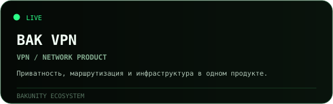
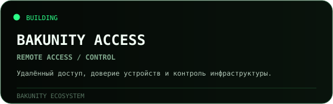
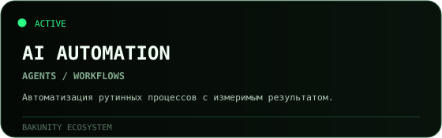
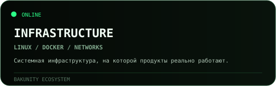
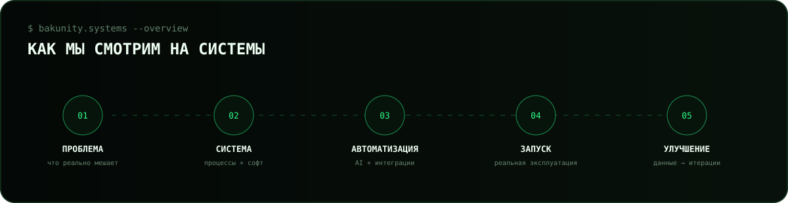

<p align="center">
  
</p>

<p align="center">
  <strong>Bakunity — технологическая экосистема продуктов, инфраструктуры и автоматизации.</strong><br/>
  Мы соединяем AI, софт, сети и системную инженерию в решения, которые работают в реальной эксплуатации.
</p>

<p align="center">
  <code>AI</code> × <code>INFRASTRUCTURE</code> × <code>AUTOMATION</code> × <code>CYBERSECURITY</code> × <code>PRODUCTS</code>
</p>

## `> core.products`

<p align="center">
  <a href="https://bakvpn.me"></a>
  <a href="https://github.com/Bakunity/RDP"></a>
</p>

<p align="center">
  <a href="https://github.com/Bakunity"></a>
  <a href="https://github.com/Bakunity"></a>
</p>

## `> system.method`



## `> what.we.build`

```text
Bakunity
├── VPN и сетевые продукты
├── удалённый доступ и управление
├── AI-агенты и автоматизация процессов
├── инфраструктура и системная инженерия
├── кибербезопасность и контроль доступа
└── собственные интернет-продукты
```

Мы не строим технологию ради технологии.  
Цель — **сокращать ручную работу, повышать контроль и превращать идеи в работающие системы**.

## `> open.source`

Публичная часть экосистемы постепенно расширяется.

- **[Bakunity RDP](https://github.com/Bakunity/RDP)** — открытая часть направления удалённого доступа.
- **[Bak VPN](https://bakvpn.me)** — сетевой продукт Bakunity.
- **[TimaBak](https://github.com/TimaBak)** — профиль основателя и экспериментальные проекты.

Часть внутренних систем и инфраструктуры развивается в приватных репозиториях.

## `> principles`

```text
01  реальная польза > демонстрация технологии
02  автоматизация > повторяющаяся ручная работа
03  инфраструктура должна быть управляемой
04  безопасность закладывается в систему, а не добавляется потом
05  запустить → измерить → улучшить
```

<p align="center">
  <strong>BAKUNITY</strong><br/>
  <sub>AI · Infrastructure · Automation · Security · Products</sub>
</p>
